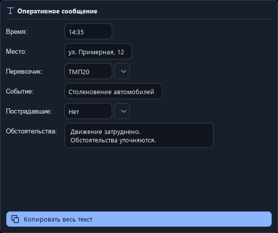

# TextTemplateBlock — визуальная правка 0.3.1

Изменена компоновка рабочего блока, без новых пользовательских функций. ID, сегменты, пресеты, SQLite, сохранение значений и команды копирования не менялись.

Подписи выводятся отдельными `Text` с `Text.PlainText`, без фона и рамок. Для обычных строк с одним полем используется `RowLayout`: подпись слева, отдельное поле значения справа. Ширина колонки подписей ограничена доступным местом; длинная подпись переносится. Ширины полей зависят от значений и доступного пространства. Внутри поля больше не повторяется название вместо подсказки; явно настроенная подсказка сохраняется.

Смешанные предложения с несколькими полями и текстом после них используют потоковую раскладку. Между строками одинаковые отступы из `Theme`. Многострочность определяется только настройкой поля. Кнопка пресетов находится справа от значения и показывается только при наличии фраз. Внизу каждого блока — одна кнопка «Копировать весь текст»; отдельного превью нет.

`InlineField.qml` переиспользует прежние компоненты `Input`/`Area`, обработчики `setValue`/`phrase` и дизайн-токены. `TextMetrics` пересчитывает ширину при разрешении шрифта, чтобы короткие значения не обрезались слева после первого кадра. `InlineMessage.qml` группирует только представление; исходные данные не преобразуются и не записываются заново.

## Фактические снимки

Изображения получены из приложения после создания настоящего происшествия через `Store.create_event` и Qt-контроллер на временных демонстрационных данных. Это захват QML-окна и самого отрисованного блока, а не макет. В соседнем блоке полного окна показаны несколько полей в одном предложении, текст после полей и длинная подпись с переносом.

| Linux Qt offscreen, 1366×768 | Тёмная тема | Светлая тема |
|---|---|---|
| Сам TextTemplateBlock | [PNG](screenshots/text-template-dark.png) | [PNG](screenshots/text-template-light.png) |
| Полная карточка происшествия | [PNG](screenshots/text-template-dark-window.png) | [PNG](screenshots/text-template-light-window.png) |

## Проверка

Локально **78 passed, 1 skipped**; пропущен только нативный Windows CF_HDROP. Пять новых GUI-проверок охватывают обе темы, ширину блока 320/560, взаимное положение подписи/поля/пресета, разные ширины полей, отсутствие обрезания коротких значений, многострочность и одну кнопку копирования. Попытка Ctrl+A, Backspace и Delete после фокусировки каждой подписи не меняет текст, снимок или значения события. Копирование по фактической кнопке даёт прежнюю точную сборку сообщения. Смешанные предложения и длинные подписи проверяются отдельно; прежние GUI-тесты пресетов, ввода и независимых событий сохранены.

Smoke-test проходит 13 экранов/окон и восемь сервисных проверок без предупреждений QML. Целевые визуальные проверки: 1920×1080 и 1366×768, обе темы, дополнительно эффективный масштаб Qt 125%. Windows workflow также запускает прежние тесты и визуальные матрицы, затем проверяет собранный EXE. Системный DPI рабочего Windows и внешние приложения не заменяются offscreen-рендером.

## Windows: итоговый проверенный вид

[Успешная сборка 0.3.1](https://github.com/Cowlizabeth2/Oper2codex/actions/runs/40111540468), код `5efb4e5`: **79 passed**, исходный и собранный EXE проходят smoke-test без ошибок QML. Целевые снимки получены при 1920×1080/1366×768 и эффективном масштабе Qt 125%, в обеих темах, с Segoe UI. Проверка захвата дополнительно отклоняет неожиданный перенос стандартной подписи при достаточной ширине. После проверки снимков подтверждено, что «Обстоятельства:» целиком находится на одной строке.

| Windows Qt offscreen, 1366×768 | Тёмная тема | Светлая тема |
|---|---|---|
| Сам TextTemplateBlock | [PNG](screenshots/windows-text-template-dark.png) | [PNG](screenshots/windows-text-template-light.png) |
| Полная карточка происшествия | [PNG](screenshots/windows-text-template-dark-window.png) | [PNG](screenshots/windows-text-template-light-window.png) |

Готовая программа находится в Artifacts → `OperationalCenter-Windows`, все снимки — в `UI-review`, результаты — в `build-diagnostics`.
